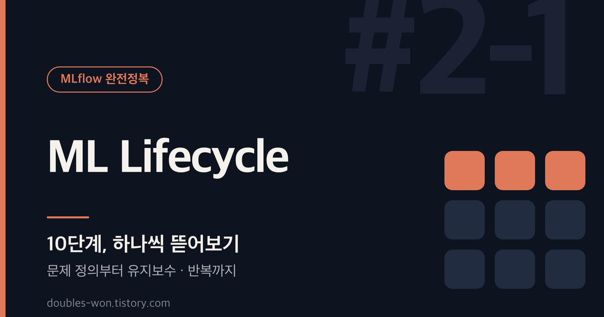

# 📝 tstory — 티스토리 블로그 포스팅 생성

강의 자료(PDF·PPTX·문서·논문)를 받아, **티스토리 글쓰기 화면에 그대로 옮겨 적을 수 있는 원고**와
썸네일·본문 도식을 한 세트로 만듭니다. 이미 만든 글을 다시 고치는 흐름도 포함합니다.



**만들어 주는 것**

| 파일 | 내용 |
|---|---|
| `post.md` | 원고 겸 작업 지시서 — 블록마다 서식 태그, 그림 자리에 파일명 |
| `thumbnail.png` | 1200×630 (@2x = 2400×1260) 대표 이미지 |
| `fig-NN.png` / `fig-NN.html` | 본문 도식과 그 원본 |
| `tags.txt` | 태그 입력칸용 |
| `build.sh` | 수정 후 전부 다시 만들기 |

**원고는 이렇게 생겼습니다**

```
(제목1)
🎯 1. 왜 10단계를 다시 보나

(본문2)
지난 편은 **"어디서 문제가 터지나"**에 초점이 있었습니다.

(fig-01.png 삽입) — ML 라이프사이클 10단계 도식
```

HTML 모드를 쓰지 않습니다. 위에서 아래로 읽으며 툴바로 서식을 지정하면 글이 완성됩니다.
`(제목1)` `(본문2)` 같은 태그는 티스토리 스타일 드롭다운 이름과 1:1로 맞춰져 있습니다.

**특징 — 추측이 아니라 실측**

- 썸네일 팔레트·좌표: 발행된 이미지의 픽셀을 직접 읽어 추출
- 문체·구성·분량 기준: 발행글 12편을 전수 조사
- 프리셋↔태그 대응: 에디터에서 직접 확인
  (티스토리는 **"제목1"이 `h2`** 입니다 — 이름이 한 칸씩 어긋납니다)

**저작권·출처 표기가 기본값입니다.** 모든 글의 상·하단에 "무엇을 참고해 공부하며 정리했는지"가
자동으로 들어가고, 남의 도식은 캡처하지 않고 새로 그립니다.

---

## 설치

홈 레포의 플러그인으로 함께 설치됩니다. 루트 [README](../../README.md#-설치)를 보세요.
설치 후 Claude Code에서 `/tstory`로 부르거나, 그냥 "이 PDF 블로그 글로 만들어줘"라고 하면 됩니다.

## 요구 사항

`tstory` 기준입니다.

| 항목 | 용도 |
|---|---|
| Python 3.9+ | 스크립트 실행 |
| Pillow | 이미지 크기 확인·트리밍 |
| matplotlib | 수치 플롯 (도식만 쓸 거면 불필요) |
| Google Chrome | HTML → PNG 렌더 (`CHROME_PATH`로 다른 경로 지정 가능) |
| 한글 폰트 | macOS 기본 Apple SD Gothic Neo면 충분. Pretendard 있으면 자동 사용 |

## 포크해서 쓰신다면

`tstory`는 [doubles-won.tistory.com](https://doubles-won.tistory.com) 한 곳에 맞춰 만든
**개인용 스킬**입니다. 다른 블로그에 쓰려면 아래를 바꾸세요.

| 바꿀 것 | 위치 |
|---|---|
| 블로그 주소 | `scripts/thumbnail.py`의 `SITE` |
| 썸네일 색·레이아웃 | `assets/thumbnail.html`의 `:root` |
| 문체·톤 | `references/voice.md` (통째로 다시 쓰는 게 빠릅니다) |
| 출처 문구 | `references/attribution.md` |
| 글 구성·아이콘 | `references/structure.md` |

문체 문서는 **본인 블로그의 기존 글에서 뽑아내는 것**을 권합니다.
그게 이 스킬이 실제로 작동하는 이유입니다.

## 라이선스

[MIT](../../LICENSE) — 마음대로 쓰시되 저작권 표시만 남겨 주세요.
